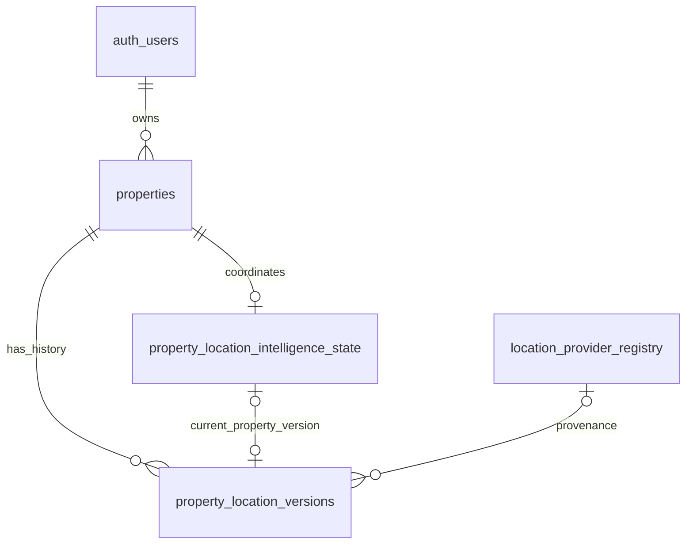

# MPIA — Phase 2A-02 schema proposal

17 October 2026 (Asia/Kuala_Lumpur). **PROPOSED, not approved or implemented.** Read with [architecture findings](PHASE2A_02_ARCHITECTURE_REVIEW.md), [decisions](PHASE2A_02_DECISION_REGISTER.md) and [readiness/tests](PHASE2A_02_IMPLEMENTATION_READINESS.md). This is a concrete review contract, not executable migration SQL.

## 1. Smallest recommended structure

Add exactly one table, `public.property_location_versions`. Add exactly one column, `current_location_version_id uuid NULL DEFAULT NULL`, to `public.property_location_intelligence_state`. The existing state row remains optional; no seed, backfill or Phase 1 application trigger is introduced. An FK necessarily creates internal PostgreSQL referential-integrity triggers, which are distinct from rewriting Phase 1 application triggers.

The diagram's pointer edge is constrained by **property plus version**, never by version UUID alone. Each property can have many immutable versions but at most one current pointer. Every version is private, including unconfirmed/historical ones. No provider candidate array, evidence table, separate Analysis Origin table, job queue or audit-event table is needed for this schema task.

## 2. Exact proposed columns

`NN` means NOT NULL. Unless specified, nullable fields default NULL; required fields have no default. UUIDs have no sequence. Text vocabularies use CHECK constraints, not PostgreSQL enums. Timestamps use `timestamptz`; database-stamped audit times are finite.

| Column | PostgreSQL type / default | Meaning |
| --- | --- | --- |
| `id` | `uuid NN DEFAULT pg_catalog.gen_random_uuid()` | Immutable version PK |
| `property_id` | `uuid NN` | Actual parent property, not a supplied owner |
| `version_number` | `bigint NN` | Positive per-property sequence, at most 9007199254740991 |
| `operation_id` | `uuid NN` | Stable server-issued command identity for retry deduplication |
| `operation_hash` | `text NN` | Lowercase 64-character SHA-256 of the canonical command, for retry-payload comparison |
| `property_input_hash` | `text NN` | Lowercase 64-character SHA-256 of the Phase 1 location-input tuple captured for this command |
| `input_address` | `text NULL` | Exact nonblank location address submitted for resolution, max 4,000 characters |
| `normalized_address` | `text NULL` | Reviewed normalized display address, max 4,000; never written back to Phase 1 |
| `normalization_version` | `text NULL` | Nonblank normalizer contract ID, max 160 |
| `longitude` | `double precision NULL` | Canonical X degrees, finite, inclusive -180 to 180 |
| `latitude` | `double precision NULL` | Canonical Y degrees, finite, inclusive -90 to 90 |
| `position` | `extensions.geography(Point,4326)` generated always, stored | Derived point or NULL; never independently writable |
| `coordinate_source` | `text NN DEFAULT 'NONE'` | `NONE`, `USER_PIN`, `GEOCODER` |
| `source_crs` | `text NULL` | For nonnull coordinates, exactly `EPSG:4326`; other source CRS inputs rejected in this phase |
| `provider_version_id` | `uuid NULL` | Exact `location_provider_registry.id`, also when normalized address is provider-derived |
| `provider_candidate_id` | `text NULL` | Permitted opaque candidate identifier, nonblank, max 1,000; no URL/token/raw payload |
| `retrieved_at` | `timestamptz NULL` | Trusted server receipt time for provider-derived data |
| `coordinate_precision` | `text NN DEFAULT 'UNKNOWN'` | `UNKNOWN`, `ROOFTOP`, `BUILDING`, `PARCEL`, `STREET`, `LOCALITY`, `REGION`, `USER_PIN` |
| `accuracy_m` | `double precision NULL` | Source-supported horizontal uncertainty in metres; strictly positive and finite; NULL means unknown |
| `geocode_confidence` | `text NN DEFAULT 'UNKNOWN'` | `UNKNOWN`, `LOW`, `MEDIUM`, `HIGH`; no fabricated cross-provider percentage |
| `confidence_mapping_version` | `text NULL` | Nonblank adapter mapping contract, max 160; required for any non-UNKNOWN confidence |
| `confirmation_status` | `text NN DEFAULT 'UNCONFIRMED'` | `UNCONFIRMED`, `REVIEW_REQUIRED`, `CONFIRMED`, `CLEARED` |
| `confirmed_by` | `uuid NULL` | Verified current owner who explicitly accepted this version |
| `confirmed_at` | `timestamptz NULL` | Database transaction time only for a newly confirmed version |
| `change_reason` | `text NN` | `INITIAL_INPUT`, `ADDRESS_CHANGED`, `GEOCODE_SELECTED`, `PIN_CONFIRMED`, `LOCATION_CORRECTED`, `METADATA_CORRECTED`, `LOCATION_CLEARED` |
| `created_by` | `uuid NN` | Verified initiating owner, including for a job originating from that owner |
| `created_at` | `timestamptz NN DEFAULT now()` | Database transaction time |

There is no mutable `updated_at`, soft-delete flag, current flag, score, coverage/freshness claim, duplicated authorization user_id or arbitrary metadata JSON. `created_by`/`confirmed_by` are provenance, not authorization. Proposed actor UUIDs deliberately have no Auth FK: an old actor's later account deletion must not block deletion or corrupt a property now under a different owner. They are not public user profiles and expose no email/name. Their retention remains subject to a separately reviewed privacy policy; D04 explicitly covers this trade-off.

`property_input_hash` is a stale-input detector, not a substitute for the captured address or an assessment snapshot. Define its canonical bytes as UTF-8 JSON array in this exact order: `['mpia-property-location-input-v1', project_name, full_address, city, district, state, postcode, country]`, retaining NULL versus empty strings and original string values. Do not include financial fields or `updated_at`; a financial-only save must not invalidate geography. A Phase 1 default country is input provenance, not independently verified geography.

`operation_hash` uses a versioned, fixed-order typed command serialization including property/actor IDs, expected state revision, expected current version, property-input hash, operation kind, and all supplied semantic location fields. Exclude generated UUID/time/position outputs. Same operation ID plus different canonical command is a conflict, not an overwrite. The exact serializer fixtures must accompany implementation; do not hash ambiguous concatenation or unordered JSON objects.

## 3. Spatial representation and validation

Proposed stored expression: when both scalar coordinates are present, construct `extensions.ST_SetSRID(extensions.ST_MakePoint(longitude, latitude),4326)::extensions.geography(Point,4326)`; otherwise NULL. `position` is the spatial projection of the scalar canonical values, not a second independent source of truth. Qualify all PostGIS functions/types; use `search_path=pg_catalog` in new guards.

The INSERT guard validates scalar coordinates **before** geography construction; declarative scalar CHECKs provide a second barrier. This rejects out-of-range values instead of relying on geography's possible coordinate normalization. Require both coordinates NULL or both nonnull; inclusive bounds reject NaN and infinities as well as ordinary out-of-range values. In particular, do not accept one NULL coordinate merely because a CHECK expression becomes UNKNOWN. Generated-column function/cast immutability must be verified in the actual installed catalog. A BEFORE trigger must not read `NEW.position`; generated values are calculated after BEFORE triggers. [PostgreSQL generated columns](https://www.postgresql.org/docs/17/ddl-generated-columns.html)

Non-NULL points must be nonempty, valid, two-dimensional POINTs with SRID 4326; typmod plus generated construction establishes shape/dimension, with explicit post-generation CHECKs for nonempty/valid where supported. No raw EWKT/GeoJSON/geography input is accepted by the future command interface. Reject unsupported CRS rather than relabel projected metres as WGS84; transformation support requires another reviewed contract.

No decimal rounding is applied before bounds checks. Double precision is storage precision, not surveying accuracy; map display rounding cannot rewrite canonical coordinates. Normalize negative zero in the command serializer. The global origin `(0,0)` is mathematically valid and must not serve as a missing-value sentinel; a later Malaysian geocoding plausibility rule should flag it for review, not silently fabricate a replacement. No Malaysia bounding box is hard-coded as a substitute for location confirmation.

## 4. Required row combinations

The following are declarative CHECKs unless a cross-row or actor check is explicitly assigned to a guard/backend. Use NULL-safe combinations, not predicates that accidentally pass UNKNOWN.

1. `NONE` means both coordinates/source_crs NULL, precision/confidence UNKNOWN, accuracy and confidence-mapping NULL. Non-NONE requires both bounded coordinates and `source_crs='EPSG:4326'`. `USER_PIN` requires precision USER_PIN; `GEOCODER` must not claim USER_PIN precision.
2. Provider candidate ID, retrieval time, non-UNKNOWN geocode confidence or confidence mapping requires `provider_version_id`. Provider ID requires finite `retrieved_at <= created_at`; GEOCODER requires provider ID. An unchanged geocoded pin that a user confirms stays GEOCODER, not USER_PIN. A moved pin can be USER_PIN while preserving provider provenance for its provider-derived address.
3. Provider FK references exact registry version. INSERT guard checks at its statement snapshot that it is not deprecated/disabled/unreviewed, includes GEOCODING, and has reviewed PERMANENT retention for the fields stored here. This conservative permanent-table restriction does not redefine registry retention classes. Field-specific lawful permission must additionally be reviewed before runtime use; the registry label alone is insufficient. No provider row is seeded. Service has registry SELECT only, so do not promise a `FOR SHARE` registry lock: PostgreSQL row-locking SELECT also requires UPDATE privilege. Preserve registry grants. A subsequent withdrawal must block new use through fresh provider-eligibility checks and the future revocation/job-cancellation contract; this guard does not serialize a concurrent administrative withdrawal or erase legally required purge obligations. [PostgreSQL SELECT privileges](https://www.postgresql.org/docs/17/sql-select.html)
4. `normalized_address` and `normalization_version` are both NULL or both present/nonblank. Normalized address requires nonblank input_address. Normalization fixes append a new version. No guessed postcode, unit, locality or default normalized address. Provider-derived text retains provider ID even if coordinates were entered manually.
5. CONFIRMED requires a point and both confirmation fields; `confirmed_by=created_by`. Guard stamps `confirmed_at=created_at=transaction_timestamp()`. All other statuses require confirmation fields NULL. Database structure checks actor consistency, while the trusted transaction validates that actor against the actual parent owner.
6. UNCONFIRMED requires input_address, no point and source NONE. REVIEW_REQUIRED requires at least input_address or a point; a multiple-match response may therefore retain an address-only review version. CONFIRMED may have a manual pin without address. CLEARED requires no point, addresses, normalization, provider or confidence metadata, and `change_reason='LOCATION_CLEARED'`. Conversely LOCATION_CLEARED requires CLEARED.
7. Confidence HIGH does not imply CONFIRMED; every candidate remains reviewable. Approximate precision remains approximate after user confirmation. `accuracy_m` never defaults to zero. Non-UNKNOWN confidence requires a mapping version; UNKNOWN requires NULL mapping. USER_PIN has UNKNOWN geocode confidence and NULL confidence mapping: moving a geocoded point cannot inherit its old match confidence, even when provider-derived address provenance remains. Precision UNKNOWN is allowed when the provider gives no reliable precision.
8. `INITIAL_INPUT` is used only for first version; `PIN_CONFIRMED` requires CONFIRMED and USER_PIN; `GEOCODE_SELECTED` requires GEOCODER and a point. Remaining reasons distinguish address, coordinate and metadata corrections. Chronology/first-version checks are enforced by the serialized transaction contract; uniqueness and positive bounds remain database constraints.

## 5. Keys, indexes and current reference

| Object | Exact proposed contract |
| --- | --- |
| Primary key | `property_location_versions_pkey (id)` |
| Parent FK | `property_location_versions_property_id_fkey`: property_id → properties(id), DELETE CASCADE, UPDATE RESTRICT, not deferred |
| Pair uniqueness | `property_location_versions_property_id_id_key (property_id,id)`; required composite-FK target even though UUID PK also exists |
| Version uniqueness | `property_location_versions_property_id_version_number_key (property_id,version_number)` |
| Retry uniqueness | `property_location_versions_property_id_operation_id_key (property_id,operation_id)` |
| Provider FK | `property_location_versions_provider_version_id_fkey`: provider_version_id → location_provider_registry(id), DELETE/UPDATE RESTRICT |
| Provider reference index | B-tree on provider_version_id WHERE nonnull, for referenced-version checks |
| Point index | `property_location_versions_position_gist`: GiST(position) WHERE position IS NOT NULL |
| Current pointer FK | `property_location_intelligence_state_current_location_fkey`: (property_id,current_location_version_id) → property_location_versions(property_id,id), MATCH SIMPLE; UPDATE RESTRICT; proposed DELETE NO ACTION, DEFERRABLE INITIALLY DEFERRED, subject to D05 |

The existing state PK indexes pointer lookup by property. The pair index covers its reference lookup because a property has only one state row; no speculative state status/queue index or duplicated property-only history index. GiST supports bounded point queries and synthetic spatial acceptance; future POI indexes belong on future POI tables. Do not publish global searches of private property points.

A NULL pointer means no selected version. A nonnull pointer means **current location intent**, including an address awaiting review or a cleared version. It does not mean an eligible Analysis Origin. Only a CONFIRMED pointed version with matching current property-input hash and validated ownership is usable for new analysis. This single-pointer meaning needs D03 approval.

Propose a new `public.guard_property_location_pointer()` BEFORE INSERT/UPDATE trigger on state, in addition to the preserved foundation guard. No replacement of the original migration/function. It rejects a new nonnull pointer unless it targets that property's newest version; permits the same pointer during unrelated state updates; rejects moving backwards or clearing a nonnull pointer to NULL (append CLEARED instead). It takes a parent `FOR UPDATE` lock before checking the latest version. A separate statement appends the version before updating the pointer, allowing the guard to see it. The composite FK remains the final integrity barrier even for bypass roles. Never infer newest by UUID or timestamp; compare version_number.

Both new guards are SECURITY INVOKER, fixed `pg_catalog` search path, schema-qualified, no dynamic SQL/network, and reject unexpected schema/table/timing/event/argument attachment. Revoke direct EXECUTE from PUBLIC and runtime roles. The accepted state guard continues to stamp revisions/times exactly once per UPDATE. Pointer guard checks pointer semantics, not the caller's missing WHERE clause.

## 6. Immutability, deletion and the D05 conflict

`public.guard_property_location_version()` attaches BEFORE INSERT/UPDATE/DELETE. INSERT validates the row and stamps audit times. Every UPDATE, including no-op, reparenting, coordinate edits, confirmation changes and upsert-update, is rejected. No role-name exception. Runtime roles receive no UPDATE or DELETE privilege on history.

DELETE guard rejects deletion while its parent property exists; only deletion after the parent has disappeared in the same cascade is allowed. Check actual parent existence, not `pg_trigger_depth()` or `current_user='postgres'`. Test this under authenticated parent deletion and Auth-user deletion; do not assume trigger security/cascade behavior from code alone. A migration owner can disable triggers/drop objects via DDL; this is operational trust, not absolute tamper resistance.

The foundation requires restricting referenced-location deletion and explicitly leaves cascade interactions for 2A-02. An immediate RESTRICT from state to history creates an order-sensitive dependency when property deletion cascades to both children: history may be visited while state still references it. **This is a design-level conflict, not a reproduced database failure.** Proposed narrow resolution D05: deferred NO ACTION on this one pointer, so both child cascades can finish before referential validity is checked. Guard/privilege denial still prohibits standalone historical deletion. This differs from literal RESTRICT and therefore requires approval, not silent substitution. PostgreSQL distinguishes deferrable NO ACTION from nondeferrable RESTRICT. [PostgreSQL FK actions](https://www.postgresql.org/docs/17/ddl-constraints.html)

At COMMIT, no dangling or cross-property pointer can survive. Transactions using a deferred FK must treat COMMIT failure as write failure and never report success beforehand. Pointer guard normally rejects a bad target earlier. Do not solve the conflict by granting service DELETE, setting pointers NULL on arbitrary history deletion, relying on trigger naming/order, or adding Phase 1 deletion triggers.

Deleting a property removes all its state and versions; deleting its Auth owner cascades through property. Global provider versions remain. No independent user deletion of history is offered. “Clear location” appends CLEARED and makes older versions historical; it is not an erasure promise. Lawful removal after data retention changes requires a separately authorized purge design; immutable storage cannot override law. Restrictive provider data is therefore excluded from this permanent table at ingestion.

Future evidence/snapshot/assessment tables must pin `(property_id,location_version_id)` to this pair, keep references immutable, and cascade coherently on property/account erasure. Do not add those FKs or choose all their deletion actions now. Their migration review must resolve multi-child cascade timing again; it cannot indiscriminately use RESTRICT and break existing property deletion.

## 7. Exact permissions and trust boundaries

`S/I/U/D` mean SELECT/INSERT/UPDATE/DELETE. This matrix is the proposed final effective authority, including inherited privileges; parent-property permissions remain unchanged.

| Principal | Location versions | Existing state + pointer | New guard EXECUTE | Notes |
| --- | --- | --- | --- | --- |
| PUBLIC / anonymous | None | None | None | No private data access |
| Authenticated current owner | S for owned property only; no I/U/D | S for owned property only; no I/U/D | None | May request future owner-authorized commands; no privileged database writes |
| Authenticated nonowner | SELECT grant but zero visible rows; no I/U/D | Same | None | Test explicit UUID and unfiltered queries, including same-owner different-property pointer attacks via backend |
| Service-role backend | S,I only | S,I,U only, preserving 2A-01 | None | BYPASSRLS is not end-user authorization; trusted actor validation mandatory |
| `authenticator` / other nonowner roles | No direct grants | No new grants | None | Review inherited and SET ROLE paths separately |
| Trusted migration owner (`postgres`, verified prerequisite) | Owner authority; DML guards still apply | Owner authority | Owner only | DDL bypass possible, tightly controlled and audited |

History gets ENABLE and FORCE RLS, with exactly `property_location_versions_select_own FOR SELECT TO authenticated USING (public.owns_property(property_id))`. No user mutation policy. Preserve the existing state policy. No service policy is needed when its verified BYPASSRLS contract holds. FORCE RLS does not constrain BYPASSRLS/superuser; grants and guards supply different protections. [PostgreSQL row security](https://www.postgresql.org/docs/17/ddl-rowsecurity.html)

Explicitly revoke materialized default grants on new objects before granting this matrix, including grant options and column ACLs. Runtime principals must lack DELETE, TRUNCATE, REFERENCES, TRIGGER, MAINTAIN, ownership, schema CREATE and direct guard EXECUTE. History also denies UPDATE. Inspect recursive role membership, INHERIT/SET/ADMIN paths, unexpected views/RPCs, public EXECUTE and default grantees. Check existing state grants already extend to its new column and remain confined to the accepted matrix. Do not modify global default ACLs, shared roles, extension objects or Phase 1 grants to make tests pass.

## 8. Atomic writer contract and concurrency

This phase proposes no browser endpoint or SECURITY DEFINER RPC. Later backend implementation must use a single database transaction; several independent Supabase REST requests are insufficient. A narrow service-only transaction function is an alternative requiring separate interface/security review if direct server transactions are unavailable.

1. Verify session/job identity and derive actor; reject decoded-but-unverified JWTs, supplied user_id, or a service key treated as user proof. Validate an allowlisted command, expected state revision (or explicit ABSENT), expected current UUID, operation identity and property-input hash.
2. Authenticate/authorize provider work before outbound processing in 2A-04, outside database locks. Bind candidate review to owner, property, input hash, expected version/revision and an expiring server-controlled request token. Candidate payloads must be validated server-side; browser confirmation is intent, not authoritative provenance.
3. Begin a short READ COMMITTED transaction. Lock `properties` by ID **FOR UPDATE**, then verify current owner equals recorded actor. Missing/deleted/transferred parent fails closed. Lock state next. A weaker FOR KEY SHARE is insufficient to serialize non-key ownership/address edits. Use a consistent parent → state lock order; read provider eligibility without widening registry grants. [PostgreSQL row locks](https://www.postgresql.org/docs/17/explicit-locking.html)
4. Recompute input hash under that lock and compare. For an existing operation_id, reauthorize and compare operation_hash: exact retry returns that recorded result without republishing it; changed payload fails. Otherwise require exact expected current UUID and state revision. Never silently rebase a stale command.
5. If state is absent, require ABSENT, create the inert row with NULL pointer (revision 0). Parent locking serializes simultaneous first writers; PK is a backup. If state exists, lock/read and enforce the supplied revision; a missing expected token is an error.
6. Allocate version_number as current maximum + 1 under parent lock; reject overflow. Insert immutable version; provider review and row constraints apply. Set pointer with `WHERE property_id = ... AND state_revision = expected` and require exactly one returned row. Existing guard advances revision once. For first creation, that predicate uses the newly created revision 0; final revision is 1. No manually supplied revision is trusted.
7. Any zero-row result, uniqueness conflict, invalid coordinate/provider, failed FK or COMMIT error rolls back both insert and state change. Future assessment applicability invalidation must join this transaction when those pointers exist; no current assessment pointer exists today. Return success only after commit.

Two commands based on the same state can produce one winner; the loser must reload and obtain a fresh explicit command. An old geocoding reply cannot retarget itself to the newest version. Ownership is checked both before provider processing and at persistence. An ownership change after successful commit affects later visibility through actual parent ownership; no copied owner field continues granting the former owner access.

**Enforcement limit carried forward:** expected-revision checks and contiguous version allocation are trusted transaction contracts, not magical consequences of a revision trigger. A raw authorized service writer can omit the predicate or insert an orphan-to-current historical candidate; it cannot overwrite history or commit a cross-property FK. This dormant capability remains within the accepted service trust model. Handler tests must prove the full contract before runtime writes are exposed; if database-enforced CAS against even a buggy service writer is required, approve a narrow function and revised grants separately (D06).

## 9. Lifecycle and applicability

| Event | Required proposed behavior |
| --- | --- |
| No known location | No state/version required; no default point. Phase 1 works normally |
| Address without coordinates | On a separately requested location command, append UNCONFIRMED, point NULL, pointer advances; no acquisition |
| Several matches | Keep options transient and provider-lawful; current review version may be address-only REVIEW_REQUIRED. Do not pick the first result. Persist only a selected candidate as a new version |
| Approximate result | Append REVIEW_REQUIRED with honest precision/confidence; confirmation never upgrades source accuracy |
| Manual map-pin confirmation | Explicit save/confirm appends CONFIRMED USER_PIN version. Pan/zoom/hover alone never writes or starts acquisition |
| Confirm unchanged geocoder candidate | Append CONFIRMED GEOCODER version retaining candidate/provider provenance; old review version immutable |
| Correction after confirmation | Append corrected/review or corrected/confirmed version according to explicit user intent; pointer switches atomically; old assessments remain historical |
| Material address change in Phase 1 | Phase 1 save completes first. Input-hash mismatch immediately withholds old origin on later Phase 2 reads/commands, even if follow-up geocoding fails. Explicit location command later appends new intent; no Phase 1 trigger or automatic provider call |
| Financial-only edit | Fingerprint unchanged; no location version, provider call or financial recalculation change attributable to geography |
| Concurrent location changes | Parent serialization plus exact revision/current-ID checks; one winner, stale loser; no last-write-wins overwrite |
| Delayed geocoder response | Require captured input hash, owner, expected version/revision and request identity; stale response discarded, not silently retried against new intent |
| Location clearing | Append CLEARED; no origin usable; retain historical rows while property exists |
| Property/Auth deletion | Accepted parent authorization, cascade all private versions/state, retain global registries; no outstanding job may recreate deleted parent |
| Owner changed before processing | Recorded actor no longer matches current owner: deny at both pre-call and transaction checks |
| Historical assessment | Resolve its pinned version and snapshot, even if current pointer differs; never substitute current map pin. Normal ownership still applies |

A future Phase 2 read must calculate effective applicability from pointer + confirmation + current input hash; the raw pointer alone is insufficient after an independent Phase 1 address edit. That rule is a required 2A-03 interface acceptance case, not implemented by this schema. A mismatch means “location needs review,” not a fabricated processing/freshness status or mutation on read.

Recommended materiality rule: any changed canonical coordinate or location-address input invalidates current applicability; any accepted persisted semantic change (including confirmation, precision, confidence, normalization or provenance) appends a new version. Do not invent a distance tolerance now. Exact idempotent retries create no duplicate. Normalization-only edits are METADATA_CORRECTED; a later policy can safely reuse eligible evidence only through explicit lineage, not silently reuse an old-location assessment. All proposed rules remain subject to D03/D04 owner review.
