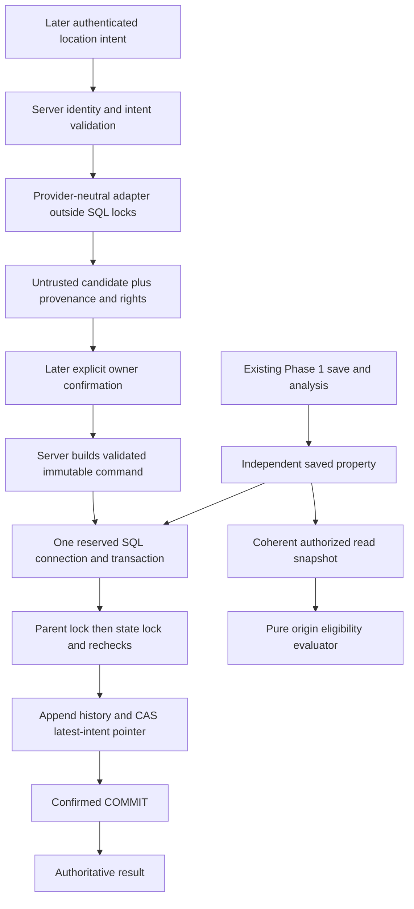

# MPIA — Phase 2A-03 DESIGN-01 architecture review

20 October 2026, Asia/Kuala_Lumpur. **Architecture proposal only; owner approval and a separate implementation instruction are required.** This review creates five Markdown documents. It implements no application code, SQL, endpoint, provider integration or deployment.

Recommendation: **CONDITIONAL GO for narrow, dormant 2A-03 implementation after design approval. NO-GO for exposing an authoritative writer or deploying it.** Preserve the accepted schema and v1 hash bytes; build validated contracts, deterministic read eligibility and an internal transaction core first. Hosting, SQL credentials and real authentication must be qualified before a runtime adapter becomes usable.

Companions: [interfaces and serialization](PHASE2A_03_INTERFACE_PROPOSAL.md), [transaction design](PHASE2A_03_TRANSACTION_DESIGN.md), [owner decisions](PHASE2A_03_DECISION_REGISTER.md), [implementation slices and gates](PHASE2A_03_IMPLEMENTATION_READINESS.md). Decision IDs `P01`–`P10` in these documents are new proposals, not inherited approvals.

## 1. Verified baseline

| Check | Observed during DESIGN-01 |
| --- | --- |
| Repository | `C:/Users/ysyap/AI Projects/malaysia-property-investment-analyzer` |
| Branch | `phase2-location-intelligence` |
| HEAD / checkpoint present | `e000da794e44619f945597e83b004895e3854a71`; exact requested commit, parent `c9b6c4acc1879a2b84b89d3b39455f2489e4c56a` |
| Initial index | Empty `git diff --cached --stat`; no staged changes |
| Initial tracked tree | Empty `git diff --stat`; no tracked changes or conflicts |
| Initial nonignored untracked files | Exactly `PHASE2A_02_GIT_CHECKPOINT_REPORT.md` |
| Local `main` | `72c2b8748d6468747b9784597b8f596e030b0dfb` |
| Recorded `origin/main` | `4f587b8a7668df04fbfac52e8f1fb31886ae791f` |
| Recorded feature tracking ref | Equal to HEAD; `HEAD...origin/phase2-location-intelligence` ahead/behind `0/0` |
| Fresh GitHub read | `git ls-remote --heads origin refs/heads/main refs/heads/phase2-location-intelligence` confirms main `4f587b8a7668df04fbfac52e8f1fb31886ae791f`, feature `e000da794e44619f945597e83b004895e3854a71` |
| Network qualification | Initial sandbox query failed to connect; the approved read-only elevated query succeeded. No fetch, ref update or push |
| Protected Phase 1 source | Git comparison with `v0.1-phase1` is empty for finance, scenarios, scoring/confidence, risk, recommendations, configuration, shared validation and analysis hook |
| Five original migrations | Git comparison with `v0.1-phase1` is empty; all remain in the seven-file migration chain |
| Foundation migration SHA-256 | `33a36f5890ce75bc3d2a035482d828224fce28a4c585911539b4856e77875393` |
| Location migration SHA-256 | `bebe96e843b5e8198fe6ec4e59d9091aea5bbec71a63e555e717cc645ca23e40` |
| Generated types SHA-256 | `ffcbec32309a369926843a99ec2b1a65ad8cf0ee500b43eee982ec105ae55347` |
| Preexisting untracked report SHA-256 | `742e3fcdee20922783221c0591e6c4a3ecd4d5522279a1b73b1fd0863cd7fe60`; retained at its root path |

Local `main` being older than GitHub main is an existing checkout fact, documented in the checkpoint report; it is not new drift and does not require synchronization for this review. No source was copied from main.

Evidence labels throughout: **VERIFIED SOURCE/GIT** means inspected now; **RETAINED EVIDENCE** means an earlier execution report; **PROPOSED** means awaiting approval; **UNVERIFIED** means no current execution/platform proof. No database connection, production Auth request, Docker operation or migration execution was performed here.

## 2. Authority and inspected sources

Read `AGENTS.md`, `PROJECT_RULES.md`, the entire [Phase 1 freeze](PHASE1_ARCHITECTURE_FREEZE.md), and entire [Phase 2 plan](PHASE2_ARCHITECTURE_PLAN.md), including all approved ARC reconciliations. Reviewed Phase 2A-01 foundation specification/final acceptance and the actual foundation migration; Phase 2A-02 architecture, schema proposal, decision register, implementation/readiness, final acceptance, transaction closure, test README and root Git checkpoint report. Inspected actual 2A-02 migration, generated types/type fixtures, command serializer, writer, runner and bounded session harness, plus current application/auth/server/build configuration.

Precedence matters: the Phase 2 plan's old “next step 2A-00” wording and older design reports' OPEN/BLOCKED labels describe their preparation dates. The explicit 2A-02 D01–D08 approval overlay, final acceptance and checkpoint record the subsequent accepted development state. The user's present instruction authorizes DESIGN-01 documents only. None of these sources authorizes implementation in this task.

## 3. Actual runtime and data capabilities

| Repository evidence | Capability and limit |
| --- | --- |
| `package.json`, installed package metadata | React 19, TypeScript, TanStack Start/Router, Supabase JS 2.116.0, Vite and Nitro. No declared SQL driver, ORM transaction manager or Deno dependency configuration |
| `vite.config.ts`, installed Lovable wrapper `dist/index.js` | Custom `src/server.ts` entry; wrapper supplies Nitro with Cloudflare default/fetch-bundle paths. This is not proof of Node TCP support or a deployed database binding |
| `src/server.ts` | Fetch-style SSR wrapper/error normalization, not a business transaction service; uncaught errors can reach console logging |
| `src/start.ts` | Global token attacher and CSRF middleware filtered to server functions. A future standalone Edge/HTTP handler does not automatically inherit it |
| `src/lib/property/*-api.ts` | Browser Supabase CRUD against `external-client.ts`, protected by existing RLS. No location call or write dependency |
| `external-client.ts`, `external-config.ts` | User-owned hosted Supabase project is the active browser Auth/data target. Its public configuration is not a synthetic test environment |
| `auth-attacher.ts` | Imports generated `./client`, rather than the active `external-client`. Its session source is not established as equivalent |
| `auth-middleware.ts` | Environment-configured generated server middleware calls `auth.getClaims(token)`. It is not currently wired into a location handler, and project equivalence with the external client is unverified |
| `client.server.ts` | Lazy HTTP Supabase admin client using a server secret. It bypasses RLS but cannot combine independent REST requests into this transaction. It is not a SQL connection |
| `supabase/config.toml` | Declares local PostgreSQL 17, Deno 2 Edge runtime and a disabled local pooler. It is configuration, not evidence those services are running on the accepted custom local target |
| `supabase/` inventory | Seven migrations, configuration; no `functions/` implementation or active geocoding worker |
| `types.ts` | Twelve table contracts; only `owns_property` in generated callable public functions. No authoritative location RPC |
| Synthetic harness | Docker/psql subprocesses on a pinned local Unix socket; `BEGIN; SET LOCAL ROLE service_role`. Test actor IDs are supplied values. This is not an application connection manager or authentication implementation |

Do not silently repair generated auth files or Lovable settings. The active browser project, Auth issuer/audience, server verification configuration and SQL database identity must all resolve to one approved target before writes (P06). A matching schema or shared type file cannot prove that identity.

## 4. Existing database contract

The actual migrations preserve all seven original Phase 1 tables: `profiles`, `properties`, `acquisition_costs`, `operating_expenses`, `financing`, `investment_criteria`, `scenario_configs`. Ownership remains `properties.user_id`; the final `owns_property(uuid)` helper is SECURITY INVOKER. Administrative transfer is possible outside normal user RLS and remains a race to handle.

The foundation adds three immutable/deprecatable registries and optional `property_location_intelligence_state`. The fact registry has the accepted 61-key vocabulary, exact unit/method/coverage tuples, seconds for route duration and the canonical four context labels. There are no fact-result tables or active registry seeds. State permits only `NOT_STARTED / UNKNOWN / NOT_ASSESSED`; 2A-03 must not activate new processing, freshness or publication states.

The location migration adds a 27-column append-only `property_location_versions` table and the eighth state column, `current_location_version_id`. It enforces finite bounded WGS84 scalar pairs, generated `extensions.geography(Point,4326)`, a partial GiST index, metadata/status combinations, service INSERT-only history, owner SELECT, immutable history, and latest-intent pointer rules. History operation uniqueness is `(property_id,operation_id)`; version uniqueness is `(property_id,version_number)`. Hash constraints check lowercase 64-character syntax, not the hash preimage.

The pointer uses the exact `(property_id,current_location_version_id)` composite FK with `NO ACTION DEFERRABLE INITIALLY DEFERRED`. It is not immediate RESTRICT. Both children cascade from property; accepted property/Auth cascade behavior is retained. No new schema, RLS, grant, guard or status change is proposed for 2A-03.

`state_revision` starts at zero and increments on every UPDATE, including a no-op; ceiling is 9007199254740991. It does not force a caller to supply an expected revision. The pointer guard may acquire the parent lock while processing a state UPDATE, so the server must lock parent first; the trigger cannot repair an incorrectly ordered writer. History INSERT does not itself lock parent to allocate contiguous versions. The trusted transaction owns those responsibilities.

PostgreSQL 17.11/PostGIS 3.3.7 in `extensions`, enabled guards and local catalog parity were established in the retained final acceptance. The migration requires PostgreSQL 17 and exactly PostGIS 3.3.7; this review does not recheck a live catalog or infer hosted compatibility. The representative GiST plan was closed in final acceptance; older README/closure text saying it remains open is historical documentation lag. Complete clean installation and adversarial platform qualification remain open.

## 5. Recommended boundaries and sequence (P01, P04–P08)

The diagram describes later behavior, not implemented routes. Providers receive no database write port, SQL connection, service key, version allocator or confirmation authority. An adapter result can become a candidate, never an authoritative version by itself. Initial Analysis Origin equals the confirmed Subject Location; a Subject Property is not a POI. Maps display stored lineage and report explicit pin intent; pan/zoom never author a version or acquire evidence.

Recommended transaction execution: an internal Deno-compatible core with an injectable reserved-connection interface; a separately qualified Supabase Edge SQL adapter is the preferred eventual host, avoiding an assumption that the Lovable deployment is a Node database server. P05 explicitly separates SQL credential authority from the already accepted service-role DML model. No Edge function entry point, network route, privileged RPC or new role/grant is part of DESIGN-01 or the initial implementation slice. Details and alternatives are in the transaction design.

## 6. Compatibility and discrepancies requiring explicit disposition

| Finding | Proposed disposition / approval |
| --- | --- |
| v1 property bytes preserve exact seven stored strings, with no Unicode normalization | Preserve byte-for-byte; NFC, trimming, case-folding or address cleanup must never be introduced under v1 (P02) |
| Operation v1 is a fixed array, not arbitrary JSON hashing | Preserve field order and numeric behavior; add strict boundary validation separately, leave historical test source untouched (P02) |
| No serializer-version column; hashes are bare digests | Support v1 only in this schema. A future serializer change requires explicit version persistence/migration review, not opportunistic dual hashing |
| Writer checks current property hash before duplicate lookup | Retain: retry after address change is INPUT_CHANGED, even if an operation once committed. Add a distinct authorized historical reconciliation read later; do not republish old intent (P03) |
| Synthetic writer looks up immutable operation before locking state | Production core will lock existing state after parent, then look up operation; no changed hash/lock inversion. This is deliberate alignment with requested parent→state order (P04) |
| Writer duplicate path ROLLBACKs and returns only ID/version/retry | Proposed runtime duplicate path ends a read-only transaction with confirmed COMMIT; returns the original immutable version and explicitly observed current state. No original state revision is invented (P03/P04) |
| Genuine server COMMIT rejection tested; lost COMMIT acknowledgement not tested | Add `COMMIT_OUTCOME_UNKNOWN` and same-ID reconciliation. Do not falsely label an ambiguous commit “rolled back” (P07) |
| Auth project/session-source mismatch is unresolved | Add new isolated verifier contracts and a target-identity gate; do not modify generated middleware during this review (P06) |
| Provider guard checks statement-snapshot eligibility, not concurrent withdrawal | Keep live ingestion disabled until field rights, withdrawal, transfer privacy and candidate receipt rules are approved in 2A-04; no registry locking grant (P08) |
| Generated types allow broad strings/Update shapes | New validated domain types narrow runtime inputs; database grants/triggers still enforce authority. No type regeneration is necessary |
| State optional; Phase 1 can edit addresses independently | Evaluate origin applicability using actual current input fingerprint on every authoritative use; financial-only changes leave it unchanged (P09) |

These are disclosed boundaries, not instructions to change protected contracts. Any owner preference for Unicode-equivalent hashes, replay-before-input-check, stronger database-enforced CAS or an alternate origin requires a separately named decision.

## 7. Phase allocation

| Phase | Recommended work |
| --- | --- |
| 2A-03 after approval | Provider-neutral contracts, strict validators, compatible serializers/identity, pure read eligibility, normalized errors, server-only transaction core, fake adapters and offline tests; actual SQL adapter qualification only as a separately gated slice |
| 2A-04 | Live provisional geocoder adapter only after narrow rights review; authenticated transport/confirmation workflow, expiring candidate receipt, budgets/timeouts, stale response rejection and approved operational status changes |
| 2A-05 | Comprehensive actual JWT/handler/role/CSRF/rate-limit and alternate-path audit; any new least-privilege login/grant or privileged RPC needs its own design approval before use |
| 2A-06 / release | Clean full-chain installation, target compatibility/adversarial qualification, all eight T15 browser cases, build/bundle and combined-tree regression |
| 2B | Places/routing adapters, provider benchmark/freeze, canonical-place/evidence/request/cache persistence and coverage/rights controls; 2C+ owns facts/context and later scoring |
| 2E | Concrete map renderer and historical evidence UI; map contract can remain a port until then |

All ten approved ARC rules remain binding: bounded coverage (01), measurement-specific methods (02), coverage gates (03), calibrated official launch (04), lawful retention (05), state separation (06), responsibility-based schema (08), provisional provider neutrality (09), context anti-circularity (10), and withholding undefined metrics (11). No scorer, fact key, confidence policy, retention permission or new status is approved here.

## 8. Verification and stopping point

Fresh offline verification: Vitest 33 files / **1,073 passed** using cache-disabled execution; existing serializer **5 passed**; source security **5 passed**, built-browser check **1 skipped**; application TypeScript and location database-type project **passed**. Commands and qualifications are listed in readiness. These checks do not execute the proposed contracts in these documents and do not establish real Auth, browser, SQL adapter or production security.

Retained local evidence includes 166 spatial assertions, 14 synthetic transaction cases, actual COMMIT rollback/cascade checks, two observed location races, and 44 preserved type contracts. These overlapping groups are not added together and were not rerun. The current runner is hard-coded to the earlier HEAD and overwrites accepted JSON; it must not be invoked casually for this review.

Final artifact integrity/status is recorded in readiness. Existing files remain unchanged. Stop after the five documents; no implementation, commit or push follows without explicit owner instruction.
