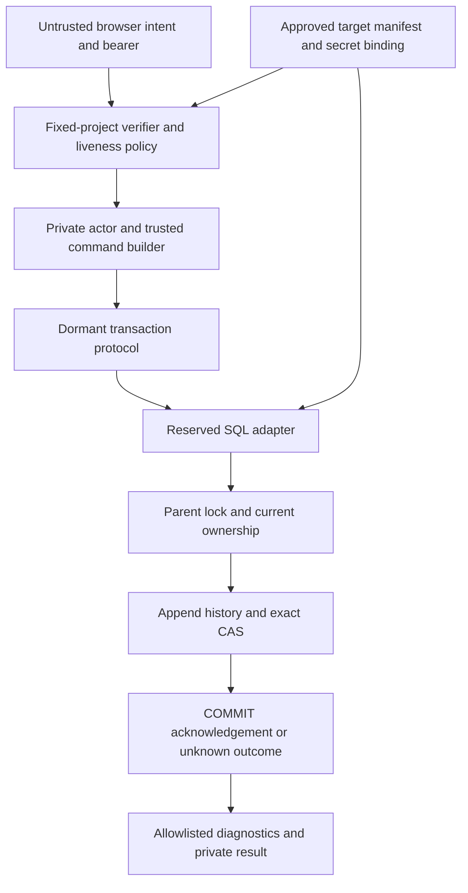

# MPIA — Phase 2A-03 I06-DESIGN-01 architecture review

20 October 2026, Asia/Kuala_Lumpur. **Design and security review only. No runtime connectivity is authorized or implemented.**

**Recommendation: CONDITIONAL GO for a separately approved, dormant I06 qualification slice; NO-GO for connecting now, exposing a writer, or deploying.** Preserve I01–I05 and qualify the adapter against its existing protocol before considering broader runtime integration. Do not use a `postgres` credential in an application runtime. A dedicated login allowed to assume `service_role` can preserve the current SQL for synthetic qualification, but remains a broad application credential. It is not the preferred production least-privilege boundary.

The preferred production direction is a dedicated capability-scoped SQL identity in a host that cannot also access project-admin credentials. This requires a separate privilege/SQL design approval. A restricted function interface is the alternative if the owner requires the database to prevent raw privileged writes. Neither option is a drop-in implementation under the present no-change authorization.

Companions: [security decisions](PHASE2A_03_I06_SECURITY_DECISION_REGISTER.md) and [qualification, slices and readiness](PHASE2A_03_I06_IMPLEMENTATION_READINESS.md). All new decisions remain proposed.

## 1. Evidence and baseline

Evidence labels used throughout:

- **F — verified local fact:** current source, installed SDK source, Git or file bytes inspected in this review.
- **H — historical evidence:** an accepted earlier execution, not rerun against a database here.
- **V — vendor behavior:** official documentation or versioned upstream source inspected on 20 October 2026; not a test of MPIA's deployment.
- **P — proposed requirement/design:** awaits the named owner decisions.
- **E — experiment required:** no runtime pass claimed.

| Baseline | Finding |
| --- | --- |
| Repository | `C:/Users/ysyap/AI Projects/malaysia-property-investment-analyzer` |
| Branch / HEAD (F) | `phase2-location-intelligence` / `1dd47b6c33b96b6a43ff3a22e2b58c733738f76f`, exact requested baseline |
| Initial tracked/index changes (F) | None |
| Initial untracked evidence (F) | Only RELEASE-01 report, checklist and JSON under `docs/`; preserved |
| Local main (F) | `72c2b8748d6468747b9784597b8f596e030b0dfb`; no ref changed |
| Preservation scope (F) | Entry inventory: 405 existing nonignored files. Final raw SHA-256 verification independently uses the retained closure/checkpoint manifests and RELEASE-01 receipt; no extra manifest created |
| Foundation migration SHA-256 (F) | `33a36f5890ce75bc3d2a035482d828224fce28a4c585911539b4856e77875393` |
| Location migration SHA-256 (F) | `bebe96e843b5e8198fe6ec4e59d9091aea5bbec71a63e555e717cc645ca23e40` |
| Generated types SHA-256 (F) | `ffcbec32309a369926843a99ec2b1a65ad8cf0ee500b43eee982ec105ae55347` |
| Corrected transaction core SHA-256 (F) | `e383293a75c4263697ffbe55fe032882b8f71b8a4dcc9db3d5031343c186ea65` |
| Remote synchronization (H) | RELEASE-01 records a normal feature-only push. No fresh remote query or remote-state guarantee in this review |

Read the [Phase 1 freeze](PHASE1_ARCHITECTURE_FREEZE.md), [Phase 2 plan](PHASE2_ARCHITECTURE_PLAN.md), [2A-02 acceptance](PHASE2A_02_FINAL_ACCEPTANCE_REPORT.md), its schema/transaction acceptance evidence, all five 2A-03 DESIGN-01 documents, implementation and correction/closure evidence, and [RELEASE-01](PHASE2A_03_RELEASE_01_GIT_CHECKPOINT_REPORT.md). Inspected the ten accepted location source modules, permanent tests/type fixtures, actual migrations and current Auth/build/server configuration. Historical NO-GO/F01 findings retain their historical meaning; correction closure and RELEASE-01 establish the later accepted dormant baseline. No current live catalog, login, Auth endpoint or deployment was inspected.

H: 2A-02 accepted local PostgreSQL 17.11/PostGIS 3.3.7 with qualifications, 166 spatial assertions, TC01–TC14, two observed lock races and genuine deferred-COMMIT rollback tests. Those groups overlap and do not qualify the new adapter. RELEASE-01 records 1,472 application tests, seven type projects and rebuilt-browser checks; fresh offline checks for this review are recorded separately in readiness.

## 2. Existing contract that a real adapter must satisfy

F: `src/server/location/transaction.server.ts` is a dormant factory with injected actor verifier, trusted command builder, connection, provider-field policy and diagnostics. There is no configured instance, endpoint or SQL driver. The facade accepts evidence and intent; it does not accept a caller actor as authentication.

The actual sequence is authentication/build/freeze/hash outside locks, then one reservation, explicit READ COMMITTED BEGIN, fixed `SET LOCAL ROLE service_role`, `search_path=pg_catalog`, local timeouts, parent `FOR UPDATE`, current owner/seven-field fingerprint, existing state lock, immutable operation lookup, duplicate or exact expected-state branch, append and pointer CAS, and explicit COMMIT acknowledgement. The pointer represents latest intent, including review/clear; usable origin still requires confirmation and matching saved input. Preserve v1 bytes, all 17 semantic fields, original receipt spelling, `(property_id,operation_id)` uniqueness and microsecond instant comparisons.

F: the core requires command-only results normalized to `rows: []`, numeric `rowCount: 0`. SELECT and DML RETURNING must have exact counts matching returned rows; CAS requires one row. It treats a thrown COMMIT as unknown, including a throw containing SQLSTATE `23503`. Only the adapter can classify a genuine completed server rejection as `REJECTED`; an aborted transaction completing with ROLLBACK is `ROLLED_BACK`. No automatic retries are implemented. WeakMap ownership and permanent object quarantine are safeguards against a broken injected pool, not physical socket eviction proof.

Preserve owner/input checks **before** duplicate lookup, and duplicates **before** new-operation expected-state checks. A duplicate never appends, increments revision or republishes an old pin. Changed input, transfer or deletion may prevent replay even after an earlier ambiguous commit. Separate authorized historical reconciliation remains unimplemented.

## 3. P05 — Actual privilege boundary and candidates

### 3.1 What the repository proves, and does not

F: migrations grant history SELECT/INSERT and state SELECT/INSERT/UPDATE to `service_role`, registry SELECT, authenticated owner SELECT, and no ordinary browser location writer. Location/state have FORCE RLS; guards are invokers with `search_path=pg_catalog`, qualified objects and constrained trigger attachments. The SQL checks hash syntax, not preimages or actual user authentication. RLS does not protect against a role with BYPASSRLS. [PostgreSQL row security](https://www.postgresql.org/docs/17/ddl-rowsecurity.html)

H: `docs/phase2a02-schema-verification.json`, interpreted using `tests/phase2a02-catalog-query.mjs`, captures `(rolsuper,rolbypassrls,rolcreaterole,rolcreatedb)`: local `postgres=(false,true,true,true)` and `service_role=(false,true,false,false)`. Thus even the retained local postgres role is not described as a PostgreSQL superuser; its ownership, creation rights and memberships still make it unsuitable for runtime use. The capture includes postgres membership in service/authenticator/read-all-data/signal-backend and other platform roles. Authenticator has SET authority for anon/authenticated/service_role with INHERIT false and ADMIN false. This is historical local evidence, not hosted authority.

**Unknown:** these role captures omit `rolcanlogin`, login password method/expiry, connection limits and a complete present-day hosted object/function/default-ACL inventory. No approved application SQL login is established. A public/service API key is not a SQL password. A database named `postgres`, an application role named `service_role`, or a matching schema does not prove project identity or safe credentials.

V: role switching relies on the session user's direct/transitive SET membership; INHERIT false does not prevent SET. LOCAL ends with the transaction, while RESET/NONE can return to session authority. SET ROLE does not apply the target role's login defaults and is prohibited inside SECURITY DEFINER functions. Therefore fixed SET LOCAL is useful transaction hygiene but cannot sandbox a more powerful login. [PostgreSQL SET ROLE](https://www.postgresql.org/docs/17/sql-set-role.html)

### 3.2 Credential/execution comparison

Hosts are separate from SQL identities. An Edge Function can run any of the feasible SQL models; calling something an Edge Function does not reduce its database authority.

| Candidate | Compatibility / changes required later | Compromise exposure and disposition |
| --- | --- | --- |
| A. Dedicated **least-privilege** LOGIN and purpose execution role, no service/admin membership | Preferred production direction. Requires new approved roles/grants/RLS and changing the core's literal service-role setup; possibly actor-context setup. Existing migrations remain immutable; any additions need their own migration/security review | Limit to location history/state, needed property columns/locks and registry reads. No finance/Auth/storage/global admin authority. Still potentially cross-user location damage if trusted server actor context is forged after compromise; not a database proof of real user consent |
| B. Dedicated LOGIN, NOINHERIT, allowed SET only to existing service_role | Preserves existing I05 SQL and accepted DML model. Needs explicitly approved login/membership provisioning and pooler compatibility. No such login is proved to exist | Bounds authority below postgres but exposes every effective service-role grant/RPC in the project. RESET returns to a restricted login, yet SET can reacquire service_role. **Preferred only for bounded synthetic qualification**, with explicit risk acceptance; not called least privilege or approved for production |
| C. Restricted SECURITY INVOKER function/RPC | New function and EXECUTE surface; invoker still needs underlying DML/RLS authority. Cannot hide raw service rights from the same invoker | Encapsulates protocol, not a privilege reduction while raw rights remain. Outer PostgREST transaction controls COMMIT; current ReservedConnection adapter is not reusable unchanged |
| D. Restricted SECURITY DEFINER capability function/RPC, execute-only caller | Strong alternative when database-enforced protocol is required. New nonlogin owner, reviewed EXECUTE grants, schema/search path, function body and raw-grant restrictions; reimplement/qualify protocol semantics and response mapping | Can prevent caller raw DML and constrain parent locking. Compromised authorized caller can still invoke permitted actions and forge an actor argument unless identity is independently verified. Highest function-review and v1 parity burden; separate D06/SQL approval |
| E. Existing postgres bootstrap + SET LOCAL service_role | Existing harness pattern; unchanged SQL if approved bootstrap available | RESET/other SET paths recover broad ownership/DDL/role authority. **Reject as runtime design**; no copying harness credentials |
| F. User-token Supabase REST calls / existing admin HTTP client | Multiple HTTP calls cannot reserve one SQL transaction. Existing browser roles have no authoritative location INSERT/UPDATE path | Reject multi-call authoritative writer. A single restricted RPC would be D, not this option |
| G. Separate small SQL service/qualified Nitro or Worker host | Can host A/B with unchanged transaction algorithm; new service/binding/package decisions required | Additional operations and network boundary, but can omit project-wide admin secrets. A signed internal request alone must not permit browser-supplied actor impersonation |

V: each PostgREST request has its own transaction. A POST RPC can atomically execute a database function, but function return is not an independent inner COMMIT. HTTP loss can still leave an unknown outcome. Functions cannot turn a series of REST requests into I05's reserved connection. [PostgREST transactions](https://docs.postgrest.org/en/stable/references/transactions.html)

### 3.3 Requirements for a true restricted identity (A)

P: separate migration/provisioning owner from runtime. Runtime LOGIN must be NOSUPERUSER/NOCREATEDB/NOCREATEROLE/NOREPLICATION/NOBYPASSRLS, own no application objects, have no ADMIN/grant options and no reachable service/admin/authenticator/platform management role. Audit PUBLIC grants and EXECUTE paths across all accessible schemas, database CONNECT/TEMP, schema CREATE/USAGE, column grants and default privileges. NOINHERIT is insufficient without reviewing per-membership INHERIT/SET/ADMIN options and transitive reachability. Membership options are distinct controls. [PostgreSQL GRANT](https://www.postgresql.org/docs/17/sql-grant.html)

Required capability inventory, **not executable grants**:

| Object | Functional need | Security constraint / unresolved detail |
| --- | --- | --- |
| `public.properties` | Read id/user_id/seven saved inputs; parent row lock | SELECT FOR UPDATE also requires UPDATE privilege on at least one column. Both core and invoker pointer guard lock this parent. Do not assume SELECT alone suffices or use a financial-column grant merely to pass qualification |
| History | Read operation/lineage/version; insert explicit nongenerated columns | No UPDATE/DELETE/TRUNCATE/TRIGGER/ownership; guards and composite FK retained |
| State | SELECT/lock, insert inert property state, update pointer, return revision/times | Column-level restrictions must accommodate both revision/pointer guards and RETURNING; no delete, property reparenting or status activation |
| Provider registry | SELECT exact eligibility fields | No seed/update/row-lock grant; registry label never substitutes for field rights |
| Functions/types/schemas | Only required type/spatial/generated-expression and invoker-helper dependencies | No CREATE in trusted paths, arbitrary RPC or trigger attachment. Trigger invocation and direct function EXECUTE are separate privilege questions |

The parent lock is a real design blocker for an absolute “no Phase 1 UPDATE privilege” policy. A raw restricted writer may need a minimal column UPDATE grant plus precise RLS, which also grants a real mutation capability; disclose and test its damage potential. A lock-only helper does not solve the existing invoker pointer guard's independent lock privilege. If that residual capability is unacceptable, use a separately reviewed full capability function/ownership design rather than secretly elevating a trigger or dropping the lock. PostgreSQL documents the locking privilege requirement. [PostgreSQL SELECT](https://www.postgresql.org/docs/17/sql-select.html)

New RLS policies must explicitly name the new role and current-owner predicate. Granting table rights without matching policies leaves a NOBYPASSRLS writer unable to operate. A transaction-local actor claim set only by the trusted server can support policies but is not cryptographic authentication: a compromised SQL identity can set it too. Do not confer authenticated/service membership just to inherit convenient policies. Exact policies, lock column, invoker dependency rights and role provisioning feasibility remain a separate review, not approved SQL in this document.

### 3.4 Function safety requirements (C/D)

P: prefer invoker semantics when privilege elevation is unnecessary. For a definer capability, use a dedicated nonlogin, non-superuser owner with only the required rights and no caller SET membership to that owner. Table ownership/BYPASSRLS must be explicit because it changes RLS enforcement. Use a trusted nonwritable schema, fully qualify tables/types/functions/operators as needed, and fix a safe search path with temporary objects unable to shadow dependencies. Revoke default PUBLIC EXECUTE and grant only the exact signature to the approved caller atomically with creation. No dynamic caller SQL, open JSON-to-row writes, overloaded bypass signature or browser-visible generic writer. Review owner replacement and schema CREATE authority as carefully as EXECUTE. PostgreSQL details definer search-path and default EXECUTE hazards. [CREATE FUNCTION security](https://www.postgresql.org/docs/17/sql-createfunction.html)

Actor argument/GUC/auth.uid() is trusted only as far as the gateway that sets it. PostgREST's verified user JWT context can establish database user identity; a service-token RPC accepting an arbitrary actor cannot. Browser-callable definer functions also need a design for trusted command/provenance construction, not simply a function signature matching the command type. V1 JavaScript JSON bytes must not be replaced with JSONB serialization. No function/RPC is approved or created now.

### 3.5 Secrets, revocation and whole-host authority

V: Supabase documents default Edge environment access to `SUPABASE_DB_URL` and project secret/service API keys. **Inference:** choosing a custom restricted DSN in code does not restrict the blast radius of arbitrary code execution if stronger injected credentials remain readable. This materially qualifies the earlier Edge-host preference. No actual deployed environment was read. [Edge environment variables](https://supabase.com/docs/guides/functions/secrets)

P: prefer a separately isolated host exposing only the selected SQL binding, fixed public Auth configuration and necessary nonprivileged keys. A Cloudflare Worker or separately operated server is a candidate; the current Lovable server is not assumed isolated. Edge remains feasible under an explicit whole-project compromise risk decision, or after independently proving stronger credentials are unavailable in the chosen execution boundary. Merely promising not to read them is insufficient.

Store SQL passwords only in approved server secret storage/bindings, never VITE variables, source, fixtures, logs or committed environment files. Use per-environment/per-service identities; separate Auth public configuration from SQL secret material. Rotation must bound overlap: provision approved replacement, verify target/rights, switch binding, drain old pools, revoke old credential and close old sessions using an operator identity. NOLOGIN/password expiry stops new logins, not established sessions. Membership/EXECUTE revocation and active-session termination must be tested; emergency disable must include every credential reachable from a compromised host. Record secret version and approval reference, never value.

Auditability must combine restricted infrastructure/DB access logs with allowlisted application outcomes. A shared SQL login does not independently attest which human consented; created_by records the trusted server's claim. Avoid raw bind/statement logging of addresses/tokens. No audit table, extension, logging service or secret store is provisioned here.

## 4. P06 — Authentication, project binding and command authority

### 4.1 Verified current wiring

F: active `external-client.ts` uses `external-config.ts` with project ref `viddikrrhogcebpbstti`. `supabase/config.toml` has the same project_id string, local PostgreSQL 17, Deno 2 and a disabled local pooler. Those static strings do not prove Auth, SQL or local services are connected. The external target is not authorized for synthetic tests.

F: `auth-attacher.ts` imports generated `./client`, whose URL/key derive from VITE/server environment. Generated `auth-middleware.ts` uses server environment and getClaims, then requires sub. It does not explicitly enforce MPIA's issuer/audience/user-token policy. No current location handler applies it. `client.server.ts` is an admin HTTP client, not a SQL transaction manager. Existing routes/hooks use real browser Auth, but their guards do not authenticate a future standalone writer. `src/start.ts` CSRF filtering covers serverFn; a new Edge/Worker endpoint needs its own transport controls later. None of these files/configurations is changed.

F: inspected installed auth-js getClaims implementation checks expiry and signature or uses online fallback, but its asymmetric path does not explicitly compare MPIA's expected issuer/audience. Therefore add explicit policy after successful verification in a new isolated verifier; do not repair generated middleware in I06. V: vendor describes JWKS verification and symmetric online fallback. [Supabase getClaims](https://supabase.com/docs/reference/javascript/auth-getclaims)

### 4.2 Fixed target manifest and verification flow (P)

Before an operational adapter exists, approve one immutable server-owned target manifest: environment ID, project ref, canonical Auth HTTPS origin/issuer/JWKS origin, expected audience `authenticated`, permitted signing algorithms, SQL endpoint/port/database/login/connection mode, TLS trust policy, secret version and schema/core evidence hashes. Custom domains/local targets require exact separately approved mappings. No request/JWT claim/header/body may select the issuer, JWKS URL, SQL DSN or project. Never fetch a caller-provided jku/x5u URL or accept an arbitrary JWKS override.

1. Parse one bounded user Bearer credential; reject missing/duplicate/ambiguous headers, API keys, service JWTs and malformed tokens. Use a request-scoped Auth client against the fixed approved target, without persistent sessions, auto-refresh or browser storage. Never share user Authorization headers globally.
2. Verify the exact token through getClaims with expiry checking enabled and only approved key sources/algorithms. After verification, enforce exact issuer, audience membership against the approved policy, finite valid exp/iat and nbf when present, canonical nonzero sub/session UUIDs, role `authenticated`, and nonanonymous user policy. Reject alg none, unsupported token classes, future/expired tokens and mismatched claims. Unknown signing keys fail closed; JWKS refresh is bounded.
3. Call getUser with that same bearer token against the same fixed project; require a real accepted user and exact equality of user.id to verified sub. Do not use user_metadata as authority. Network failure or either verification error prevents SQL acquisition. V: getUser performs an Auth server request. [Supabase getUser](https://supabase.com/docs/reference/javascript/auth-getuser)
4. Require session liveness/revocation proof as below. Stamp verifiedAt on the server and construct the internal actor only after all checks. Keep session/expiry/target attestation in private verifier/execution context; do not add fields to the core's exact three-field actor object or change v1 hashes.
5. Keep the verified identity and frozen intent request-local. Derive actor/created_by/confirmed_by server-side. Acquire a connection only from the target-bound port; check target attestation before location DML. Under parent lock, compare current `properties.user_id` to that verified user, then hash the current saved seven fields. No caller owner field, cached property or prior successful receipt overrides this check.

Auth freshness must cover acquisition/lock wait: reverify at confirmation and each new invocation, bound queueing and require sufficient token lifetime for the admitted transaction window or abort before mutation. If the fixed core cannot support an additional freshness check at a required point, stop for an explicit core-change decision. Do not perform Auth network I/O while holding SQL locks. Define authorization as the verified admission followed by locked ownership validation; instantaneous revocation racing an already admitted transaction is not guaranteed. Strict revocation-at-COMMIT would need a separately designed coordinated database/session mechanism.

### 4.3 Revocation is an explicit gate

V: Supabase documents session_id linkage and a database session check for sensitive actions after sign-out. JWT signature validity alone is insufficient; session lifetime settings can also have delayed cleanup. [Supabase sessions](https://supabase.com/docs/guides/auth/sessions)

F/V: installed getUser code handles a missing-session error; current upstream Auth source rejects a supplied session_id absent from its session store. This is evidence of a possible online enforcement path, **not proof of the target's deployed Auth version or all revocation policies**. [Auth session lookup source](https://raw.githubusercontent.com/supabase/auth/master/internal/api/auth.go)

P/E: qualification must prove logout/global logout, session deletion, disabled/deleted users, refresh revocation, key rotation and configured timeout semantics using the actual approved Auth service. If getUser on that target does not enforce the required policy, **do not substitute expiry-only acceptance**. Propose a narrowly scoped verified-session liveness oracle under separate function/grant approval, without broad auth.sessions access or project-admin secrets in the writer. Until that exists and passes, P06 remains blocked. A revoked credential observed before admission must fail without any write.

### 4.4 SQL belongs to the same authorized project

P: trust a control-plane/operator attestation mapping the Auth project and SQL endpoint, backed by certificate/hostname verification and a target manifest. Later preflight must verify database/session_user/effective role, endpoint/pooler project routing, expected catalog/guards/version, and approved Auth user/session association on that exact SQL target. Project-specific direct endpoints or pooler username suffixes are supporting checks, not standalone proof. `current_database()='postgres'`, same UUIDs, same schema, a shared local JWT secret or matching config.toml are insufficient.

Use two explicitly approved synthetic projects/instances for wrong-target tests, deliberately including overlapping user UUIDs where feasible. A correctly verified project-A token combined with a project-B DSN must fail target binding before location DML, even if both accept the same role name. Manifest identity/config validation can reject before connection; unavoidable SQL identity probes must be read-only and occur only on authorized test targets. No probe against an arbitrary caller DSN is permitted.

### 4.5 Browser intent cannot become trusted command construction

P: production `ServerCommandPort.construct` must translate a narrow allowlisted intent using server-loaded saved inputs, explicit user action and trusted receipts. Reject caller actor, issuer, generated IDs/version/times/geography, operation hash and provider/rights assertions. A syntactically valid TrustedLocationCommand or TypeScript brand is not provenance. The test fake's command passthrough and WeakMap synthetic actors must never be used as runtime implementations.

For initial I06 tests, permit synthetic manual pin/clear/unconfirmed intents only through a private test harness with real synthetic user verification. Reject geocoder/provenance intents until reviewed field policy and receipt authority exist; no live provider or seeds are needed. Preserve captured expected tokens/input and original operation/receipt on retry; do not silently build a new command from current state. Browser re-submission of an envelope is untrusted until the builder validates its authorized binding. Candidate receipt/confirmation transport remains 2A-04.

## 5. Threat model and trust boundaries

P: the database, Auth service, host operator and deployment/secret control plane are trusted at different scopes. User/browser/provider inputs and network failure are adversarial. A stolen user token has that user's current rights; a stolen service/SQL credential can have wider rights. Hashes detect stale/conflicting content; they are neither signatures nor privacy protection.

| Threat | Required boundary | Residual / stopping rule |
| --- | --- | --- |
| Forged actor/token, wrong issuer/project, SSRF via JWKS | Fixed target + real verification + explicit claims policy | Reject before write reservation; outages fail closed |
| Valid user A accessing B's property/history | Locked current parent ownership; independent owner RLS for browser reads | Uniform external unavailable response; no owner/history leak |
| Browser impersonates builder/provider | Closed intent construction, server receipt/policy, generated fields denied | No geocoder path in initial qualification |
| SQL injection or role identifier injection | Fixed SQL/identifiers, bound values only | No generic query endpoint or runtime SQL rewriting |
| Runtime compromise | Restricted reachable credentials/grants and secret-isolated host | Service-role qualification has project-wide application blast radius; Edge default admin secrets can enlarge it further |
| Concurrent pin/address/transfer/delete | Parent then state locks, original fingerprint/tokens, exact CAS | Later edits may supersede a committed observation; no perpetual access promise |
| Connection alias/reuse, cancellation race | Physical reservation, generation ownership, synchronous quarantine | WeakMap identity cannot detect two wrappers over one socket; real tests required |
| Lost COMMIT reply | Explicit unknown; same-ID replay/reconciliation | No fresh-ID retry, rollback claim or historical certainty after deletion |
| Logs/APM/driver/DB leak private values | Closed diagnostic projection and sink qualification | Safe application diagnostics alone do not close this gate |

## 6. G02 — Host and driver qualification

### 6.1 Current support and candidate disposition

F: package.json contains Supabase JS but no declared PostgreSQL driver. The installed Lovable wrapper supports `cloudflare-module` and `lovable-fetch-bundle`, with a Cloudflare default. This establishes neither a Node TCP server nor an existing Hyperdrive binding. No driver was installed or imported by this review.

| Candidate | V: documented support | P/E: MPIA disposition |
| --- | --- | --- |
| Deno 2 + `@db/postgres` | Supabase's Edge SQL example acquires/releases a Deno Postgres client; JSR currently exposes 0.19.5 | First Deno qualification candidate, not selected runtime. Prefer bounded per-invocation standalone Client initially, because pooled destructive eviction is not established. Must solve decoder logging, microseconds, cancellation and packaging |
| Isolated Node host + node-postgres (`pg`) | Explicit same-client transactions and native result command/count APIs; pool supports destructive release | Preferred reference qualification host/driver pair if owner approves a separate Node host. Not a reason to retarget the existing Lovable build |
| Cloudflare Worker + pg + Hyperdrive | Cloudflare currently recommends pg and documents minimum 8.16.3, Node compatibility and binding requirements | Preferred candidate for secret-isolated hosting within the existing platform family. Requires exact runtime/build/route/TLS/binding/cache and physical backend tests; no new Worker/binding created |
| Postgres.js on Node/Deno/Worker | Upstream documents reservation, parameter binding, transactions and cancellation | Alternative. Current Supabase shared transaction pooler guidance warns of pipelining problems and broken `max_pipeline:0` transactions; not the default qualification route |
| PostgREST RPC | Atomic request transaction | Alternative architecture C/D, not implementation of ReservedConnection. Needs distinct SQL/EXECUTE/COMMIT/error qualification |

Support sources: [Supabase Edge SQL pattern](https://supabase.com/docs/guides/functions/connect-to-postgres), [Deno package API](https://jsr.io/@db/postgres/doc), [pg transactions](https://node-postgres.com/features/transactions), [Cloudflare supported drivers](https://developers.cloudflare.com/hyperdrive/examples/connect-to-postgres/), [Supabase Postgres.js warning](https://supabase.com/docs/guides/database/postgres-js).

No broad latest-version range should be copied into implementation. Approve exact driver/runtime/transitive lock integrity, support/security review and import strategy. A published version and documentation example establish availability, not a maintenance/security assurance. Recheck these time-sensitive findings when implementation is authorized.

### 6.2 Driver behavior matrix

All entries below are **V/F source findings plus P adapter requirements**. None is an MPIA runtime pass. `E` names the experiment that must close the gap.

| Capability | Deno `@db/postgres` 0.19.5 candidate | node-postgres candidate | Postgres.js candidate / common gate |
| --- | --- | --- | --- |
| Reservation and explicit SQL | Acquired PoolClient or standalone Client can issue sequential raw statements. Use the existing BEGIN/SET/COMMIT text, not a second transaction wrapper | One checked-out client for the entire protocol; never pool.query per statement | reserve is available; do not nest an automatic begin around core BEGIN. E: same backend through completion |
| Bound parameters | queryObject text + args matches positional SQL | client.query(text,values) | Raw fixed text must use bound args through the appropriate API, not string interpolation. E: hostile text remains data |
| Counts / tags | Versioned source parses command text and may produce NaN for uncounted commands; its CommandType union omits COMMIT/ROLLBACK despite runtime tag parsing | result.command is separate; rowCount may be null for commands without a count | count/command metadata require exact version review. E: setup => empty/0; SELECT/RETURNING exact; COMMIT vs ROLLBACK distinct |
| bigint | Default int8 decoder uses BigInt; core accepts exact bigint/string or safe numbers | Preserve int8 as exact string/custom parser | No Number coercion before bounds. E: 0, 1, 9007199254740991 and rejection above, no rounded equality |
| Coordinates | Default float decoder produces numbers; strict finite parsing and binary64 parameter fidelity need tests | Float8 parser/encoder must preserve binary64 | No decimal truncation, JSONB rehash or coordinate rounding. E: full precision, extremes, 0/-0, subnormal/exponents |
| UTC microseconds | Default timestamp decoder makes Date, losing submillisecond precision; use raw strings/custom decoding before Date | Default dates lose microseconds; use per-client timestamp parser preserving text | Date-based defaults cannot meet core. E: exact .000001/.123456 and offset conversion, no reformatting original receipt bytes |
| Timeouts | Core SET LOCAL statements and JS budgets require working server enforcement and bounded close | Driver query_timeout is not proof server work stopped; use core server timeouts and cancellation/close qualification | E: actual lock/statement/idle timeout, canceled work/session disappearance and lock release |
| Abort/cancellation | No public AbortSignal query cancellation established from reviewed API; end writes termination before closing, so hard bounded interruption is unproved | Do not assume generic AbortSignal support; exact version/API must be reviewed | Upstream cancellation uses another connection and warns of races. E: no late cancel reaches the next borrower |
| Eviction | release returns pooled client; no destroy-on-release established. First qualification should avoid reusable driver pool until proved | pool release(true) destroys a checked-out client; wrapper must synchronously prevent reuse before async cleanup | reserved.release is reuse, not discard. E: socket/generation ownership, late acquire/release, cancellation, quarantine and no resurrection |
| COMMIT certainty | Raw result tag plus completed protocol required; map known server rejection inside adapter | command tag and completion/error provenance; not merely promise fulfilled | For all: acknowledged COMMIT => success; known ROLLBACK/rejection => failure; transport/cancel/loss => UNKNOWN |
| TLS | Enforce TLS/CA/hostname, no fallback | Verify certificate and endpoint with correct SSL configuration | E: invalid CA/hostname/plaintext rejection, direct/pooler/proxy endpoint attestation. Local plaintext only under explicit isolated-test exception |
| Prepared statements / pooler | No named persistent query state; prove selected extended protocol and no cross-transaction reliance | Unnamed parameterized statements initially; named statements only if exact pooler supports them | Pooler policies differ. Supabase transaction mode and Hyperdrive require separate decisions; never copy prepare:false universally |
| Lifetime / packaging | Deno imports, Web Crypto, extensionless core imports and actual Edge bundler remain unqualified | Existing Node tests are not deployment proof | No providers/Auth I/O in locks, no durable background work; bounded global connection budget and teardown required |

Relevant primary detail sources: [Deno result parser](https://raw.githubusercontent.com/denodrivers/postgres/v0.19.5/query/query.ts), [default Deno decoding](https://raw.githubusercontent.com/denodrivers/postgres/v0.19.5/query/decode.ts), [Deno Date/number decoders](https://raw.githubusercontent.com/denodrivers/postgres/v0.19.5/query/decoders.ts), [Deno client lifecycle](https://raw.githubusercontent.com/denodrivers/postgres/v0.19.5/client.ts), [Deno connection lifecycle](https://raw.githubusercontent.com/denodrivers/postgres/v0.19.5/connection/connection.ts), [pg result](https://node-postgres.com/apis/result), [pg types](https://node-postgres.com/features/types), [pg pool](https://node-postgres.com/apis/pool), [pg client](https://node-postgres.com/apis/client), [pg SSL](https://node-postgres.com/features/ssl), [Postgres.js APIs and cancellation](https://github.com/porsager/postgres).

### 6.3 Adapter normalization and connection policy

P: normalize command-only counts only for fixed expected successful command tags with no rows. Never blanket-coerce a missing/NaN DML count to zero or substitute rows.length for a contradictory completion count. Reject multiple result sets/unexpected tags. Require full command completion before success. PostgreSQL protocol separates CommandComplete from ReadyForQuery and transaction state; test how the exact driver exposes or consumes them. [PostgreSQL message flow](https://www.postgresql.org/docs/17/protocol-flow.html)

P: use raw UTC timestamp text/custom decoders preserving six fractional digits; parse/validate calendar and offset before emitting the core's Z form. Fractions must never pass through Date and be reconstructed. Preserve null and reject infinities/out-of-range dates. Handle scalar OIDs, booleans and provider capabilities arrays explicitly. If Deno string strategy is chosen to avoid its default auto-decoder catch-and-console path, the adapter must safely parse every selected type, including text arrays. Decoder failures must throw a sanitized integrity failure, never become null/default values or private console output. Real logging fault tests remain mandatory.

P: reserve the underlying socket/generation for one invocation; wrappers must not hide an alias by manufacturing another JS object. Discard marks that physical generation unusable synchronously, then attempts bounded close. No subsequent query/reconnect/release callback may resurrect it. An old timed-out release must not free a new borrow. If a library cannot force close stalled network I/O within the approved budget, it fails qualification; do not patch driver internals or silently extend deadlines.

The core's current provisional budgets are Auth/build wait 2s, acquire 2s, statement 5s, transaction 8s, cleanup 1s per operation; SQL lock 3s, statement 5s, idle-in-transaction 10s. They are **F existing constants**, not measured service-level targets. A cleanup release may be followed by its own discard budget. Node/Deno/Worker lifetime and Auth latency must be measured before changing them under an explicit decision.

For direct/session mode, one reservation has a stable backend for the transaction. For transaction poolers, the physical backend need only remain pinned **from BEGIN through COMMIT/ROLLBACK**, not across requests; loss/reassignment midtransaction fails the contract. Supabase distinguishes direct/session/transaction routes and connection/prepared-statement constraints. No current local pooler is proved running. [Supabase connection modes](https://supabase.com/docs/guides/database/connecting-to-postgres)

V: Hyperdrive documents transaction affinity and transaction-scoped SET handling, but also caches reads without automatic write invalidation. P: require a cache-disabled binding for ownership/current-state/replay/reconciliation; qualify the proxy and origin TLS legs, cancellation and backend cleanup separately. Never place Hyperdrive in front of another transaction pooler by accident. Its documented named-statement support differs from Supabase shared pooling, so assess the actual route. [Hyperdrive behavior](https://developers.cloudflare.com/hyperdrive/concepts/how-hyperdrive-works/), [query cache controls](https://developers.cloudflare.com/hyperdrive/concepts/query-caching/)

P: retain one physical connection per admitted operation initially; pool/client reuse is optional and gated. Bound aggregate instances/concurrency, connect queues, application deadlines and server idle cleanup. Do not retain user tokens/actors in globals or assume serverless background cleanup will run after response/process termination. Edge limits are platform-specific and must be checked on the selected account/runtime. [Edge limits](https://supabase.com/docs/guides/functions/limits)

## 7. Recommended execution model and unresolved decisions

For **first I06 qualification**, prefer the unchanged dormant core, online fixed-project verifier, private synthetic intent builder and one reserved real SQL client against an explicitly authorized nonproduction Auth+SQL pair. If the owner chooses to preserve all current SQL, candidate B is the reviewable privilege compromise: dedicated no-admin login with only approved service-role SET membership, never postgres, no inferred credentials, and a complete effective-grant inventory. Hosted execution is unnecessary to begin local qualification. Exact host/driver installation remains separately approved.

For **production**, prefer A in a secret-isolated host, or D if the database must prevent raw protocol bypass. A new role is not sufficient without resolving property-lock privilege, RLS/invoker dependencies and changing the literal role setup. Edge's auto-injected admin credentials prevent claiming a narrow whole-host boundary unless the platform configuration actually excludes them; otherwise the owner must explicitly accept a much wider blast radius or choose another host. This review recommends the isolated-host direction instead of accepting that risk by default.

P05/P06/G02 remain **open**. Owner decisions must name the privilege ceiling, host secret boundary, exact target pair, session revocation semantics, driver/version/mode, packaging and whether SQL/grant changes are permitted. Readiness defines experiments and stop conditions. Completion of these documents authorizes none of those operations and closes none of the real-runtime gates.
